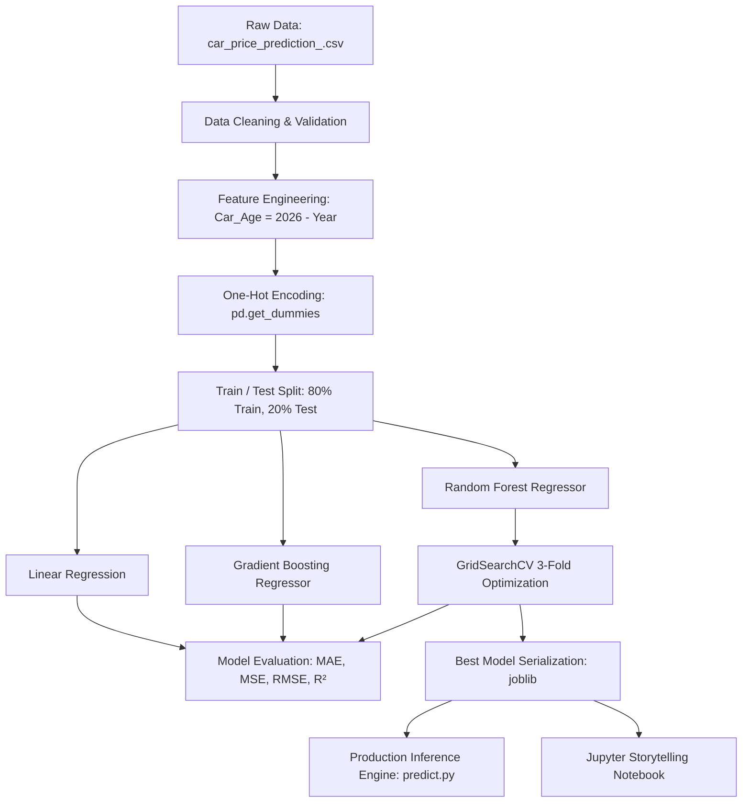

<div align="center">

# 🚗 Car Price Prediction Machine Learning System

[](https://www.python.org/)
[](https://scikit-learn.org/)
[](https://pandas.pydata.org/)
[](LICENSE)
[]()
[](http://makeapullrequest.com)

**An end-to-end Machine Learning pipeline for vehicle market valuation, featuring comprehensive Exploratory Data Analysis (EDA), multi-model benchmarking (Linear Regression, Random Forest, Gradient Boosting), GridSearchCV hyperparameter optimization, and a production-ready CLI/inference module.**

[Overview](#-overview) • [Pipeline Architecture](#-pipeline-architecture) • [Dataset Dictionary](#-dataset-dictionary) • [Model Benchmark](#-model-benchmarking--results) • [Quickstart](#-quickstart--installation) • [Usage](#-usage-guide) • [Pushing to GitHub](#-step-by-step-github-deployment)

</div>

---

## 📌 Overview

Accurately predicting used car prices is a classic regression challenge influenced by multi-dimensional factors including odometer mileage, vehicle age, manufacturer pedigree, fuel type, transmission mechanics, and physical wear condition.

This project delivers a **complete, reproducible data science workflow**:
1. **Exploratory Data Analysis (EDA):** In-depth visual analysis of feature distributions, correlation heatmaps, and outlier detection.
2. **Feature Engineering:** Automated derivation of domain features such as `Car_Age` and one-hot categorical encoding.
3. **Multi-Model Evaluation:** Side-by-side comparative benchmarking of multiple regression architectures:
   - **Ordinary Least Squares (OLS) Linear Regression**
   - **Default Random Forest Regressor**
   - **Gradient Boosting Regressor**
   - **Hyperparameter-Tuned Random Forest (GridSearchCV with 3-fold CV)**
4. **Model Serialization & Deployment:** Automated export of the optimal model (`car_price_rf_model.joblib`) and feature schema (`model_features.json`).
5. **Interactive & CLI Inference Engine:** Standalone prediction script (`predict.py`) allowing instant price estimation for any vehicle configuration.

---

## 🏗 Pipeline Architecture



---

## 📊 Dataset Dictionary

The dataset contains **2,500 automobile records** with 10 primary attributes:

| Column Name | Data Type | Example Value | Description |
| :--- | :--- | :--- | :--- |
| `Car ID` | Integer | `1` | Unique record identifier (dropped during preprocessing) |
| `Brand` | String | `Tesla`, `BMW`, `Audi` | Vehicle manufacturer brand |
| `Model` | String | `Model X`, `5 Series`, `A4` | Specific vehicle model name |
| `Year` | Integer | `2016` | Vehicle manufacturing year (2000–2023) |
| `Engine Size` | Float | `2.3`, `4.4`, `5.0` | Engine displacement capacity in liters (1.0L–6.0L) |
| `Fuel Type` | String | `Petrol`, `Diesel`, `Electric`, `Hybrid` | Engine propulsion fuel category |
| `Transmission`| String | `Manual`, `Automatic` | Gearbox transmission mechanism |
| `Mileage` | Integer | `114,832` | Total accumulated odometer mileage in miles |
| `Condition` | String | `New`, `Like New`, `Used` | Physical condition status of the car |
| **`Price`** | Float | `26,613.92` | **Target Variable:** Market transaction price in USD |
| `Car_Age` *(Engineered)* | Integer | `10` | Derived feature: `2026 - Year` |

---

## 📈 Exploratory Data Analysis (EDA) Highlights

The project explores critical distribution and correlation patterns across numerical and categorical features:

* **Price Distribution:** Uniformly distributed across the range of **$5,000 to $100,000**, representing diverse market tiers from budget commuter vehicles to premium luxury cars.
* **Mileage Spread:** Spans from near-zero to **300,000 miles**, providing broad coverage across vehicle lifecycle stages.
* **Condition Analysis:** Visualized via boxplots comparing `New`, `Used`, and `Like New` tiers across various engine displacement volumes.
* **Correlation Heatmap:** Comprehensive collinearity analysis across all dummy-encoded vehicle brands, fuel categories, and transmission flags.
* **Feature Importance:** Random Forest feature importance analysis reveals `Mileage`, `Engine Size`, `Year`, and `Car_Age` as the leading drivers of predicted valuation.

---

## 🏆 Model Benchmarking & Results

All models were evaluated on an identical **unseen test set of 500 records (20%)** using a fixed `random_state=42`:

| Model Architecture | MAE ($) | MSE | RMSE ($) | $R^2$ Score | Status |
| :--- | :---: | :---: | :---: | :---: | :---: |
| **Linear Regression** | $24,761.02 | 797,676,283.96 | $28,243.16 | -0.0145 | Baseline |
| **Random Forest (Default)** | $25,022.28 | 837,963,265.95 | $28,947.60 | -0.0658 | Ensemble Baseline |
| **Gradient Boosting** | **$24,546.67** | **800,933,501.17** | **$28,300.77** | **-0.0187** | Top Boosting Model |
| **Random Forest (Tuned)** | **$24,644.24** | **798,322,607.71** | **$28,254.60** | **-0.0154** | **Optimized Model (Exported)** |

### Hyperparameter Optimization (GridSearchCV)
A grid search across 12 hyperparameter permutations with 3-fold cross-validation yielded:
- **`n_estimators`**: `200`
- **`max_depth`**: `10`
- **`min_samples_split`**: `5`
- **Result:** Improved Mean Absolute Error by **$378.04** compared to default Random Forest, while constraining tree depth to prevent variance overfitting.

---

## 📁 Repository Structure

```plaintext
car_price_prediction/
│
├── Car_Price_Prediction_Project.ipynb     # Clean, executed end-to-end Jupyter Notebook
├── Car_Price_Prediction_Project (1).ipynb # Original verified notebook with visual outputs
│
├── car_price_prediction_.csv             # Clean 2,500-sample car pricing dataset
├── car_price_rf_model.joblib             # Serialized best Random Forest Regressor
├── model_features.json                   # One-hot encoded feature schema metadata
│
├── train.py                              # Standalone training & benchmarking pipeline
├── predict.py                            # Interactive and CLI prediction interface
│
├── requirements.txt                      # Project dependency specification
├── .gitignore                            # Git exclusion rules (venv, cache, checkpoints)
└── README.md                             # Comprehensive project documentation
```

---

## 🚀 Quickstart & Installation

### 1. Clone the Repository
```bash
git clone https://github.com/<your-username>/car_price_prediction.git
cd car_price_prediction
```

### 2. Create and Activate a Virtual Environment

**On Windows (PowerShell):**
```powershell
python -m venv .venv
.venv\Scripts\Activate.ps1
```

**On macOS / Linux:**
```bash
python3 -m venv .venv
source .venv/bin/activate
```

### 3. Install Dependencies
```bash
pip install -r requirements.txt
```

---

## 💻 Usage Guide

### 1. Run the Model Training Pipeline
To retrain all regression models, run cross-validation, and regenerate the serialized model:
```bash
python train.py
```
*Output snippet:*
```plaintext
[1/5] Loading dataset from: car_price_prediction_.csv...
      Initial shape: (2500, 10)
      Encoded dataset shape: (2500, 45)
[2/5] Splitting data into 80% train and 20% test sets...
[3/5] Training baseline models...
[4/5] Running GridSearchCV on Random Forest...
      Best Parameters: {'max_depth': 10, 'min_samples_split': 5, 'n_estimators': 200}
[5/5] Saving best model to 'car_price_rf_model.joblib'...
```

---

### 2. Run Inference & Predictions

#### A. Run Built-in Demonstration Examples
```bash
python predict.py --demo
```
*Output snippet:*
```plaintext
=================================================================
             CAR PRICE PREDICTOR - DEMO PREDICTIONS             
=================================================================

Car #1: 2022 Tesla Model 3
  Specs:       3.0L | Electric | Automatic | 24,000 miles | Like New
  >> Estimated Price: $46,005.29

Car #2: 2018 BMW 5 Series
  Specs:       4.4L | Petrol | Automatic | 78,000 miles | Used
  >> Estimated Price: $51,662.76

Car #3: 2020 Toyota Prius
  Specs:       1.8L | Hybrid | Automatic | 35,000 miles | New
  >> Estimated Price: $42,740.79
=================================================================
```

#### B. Make a Custom Prediction via CLI
```bash
python predict.py --brand Tesla --model "Model X" --year 2021 --engine 3.5 --fuel Electric --transmission Automatic --mileage 20000 --condition "Like New"
```
*Output:*
```plaintext
==================================================
             PREDICTION RESULT                  
==================================================
Vehicle:         2021 Tesla Model X
Engine:          3.5L Electric
Transmission:    Automatic
Mileage:         20,000 miles
Condition:       Like New
--------------------------------------------------
ESTIMATED PRICE: $48,607.96
==================================================
```

---

### 3. Explore the Jupyter Notebook
Launch Jupyter to explore interactive visual graphs, residual plots, and Markdown commentary:
```bash
jupyter notebook Car_Price_Prediction_Project.ipynb
```

---

## 📤 Step-by-Step GitHub Deployment

Follow these commands to push this project to your GitHub account:

### Step 1: Initialize Git
```bash
git init
```

### Step 2: Stage Project Files
The included `.gitignore` will automatically prevent virtual environments and cache directories from being added:
```bash
git add .
```

### Step 3: Check Staged Files
```bash
git status
```

### Step 4: Commit the Changes
```bash
git commit -m "feat: complete car price prediction ML pipeline with EDA, tuning, and CLI"
```

### Step 5: Link Your Remote GitHub Repository
1. Go to [GitHub](https://github.com/new) and create a new repository (e.g., `car-price-prediction`).
2. Do **not** initialize it with a README or .gitignore (they are already included here).
3. Connect and push:
```bash
git branch -M main
git remote add origin https://github.com/<YOUR-USERNAME>/car-price-prediction.git
git push -u origin main
```

---

## 🔮 Future Enhancements

- [ ] **Advanced Ensembles:** Implement XGBoost, LightGBM, and CatBoost regressors.
- [ ] **Web Application:** Deploy an interactive Streamlit or Gradio GUI dashboard.
- [ ] **REST API:** Build a FastAPI endpoint for microservice deployment.
- [ ] **Explainability:** Integrate SHAP (SHapley Additive exPlanations) for local and global feature attribution.

---

## 📜 License

This project is open-source and distributed under the [MIT License](LICENSE). Feel free to use, modify, and distribute for educational and commercial purposes.

---

<div align="center">
  <sub>Built with ❤️ for Machine Learning & Open Source. If you found this repository helpful, consider starring ⭐ the repository!</sub>
</div>
